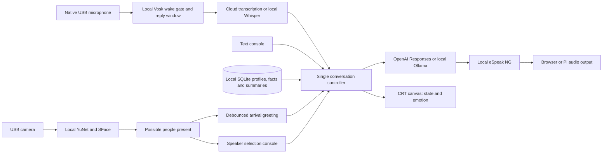

# Architecture and behavior

## Division of work

`app.py` owns one robot state, one active speaker, and one asynchronous turn lock. Its API is loopback-only; host and origin guards prevent ordinary cross-site access. No cloud secrets appear in the browser. `brain.py` is the only module making inference requests. `memory.py` is a locked SQLite store. `camera.py` runs capture/inference on a background thread. `audio.py` is a separately started half-duplex worker. The browser polls state at 2 Hz; canvas animation runs independently.

State progresses idle → listening/transcribing → thinking → speaking → idle. Playback completion uses a turn ID, so an old completion cannot end a new utterance. A watchdog eventually releases speaking state if playback disappears. A unique session token also accompanies browser/native recordings and browser messages, rejecting stale submissions before transcription. Pause or speaker switch increments a generation, clears ephemeral history, and prevents an in-flight response from being played or assigned to the new speaker. An already-submitted cloud request may still incur charges when its response is discarded.

Server restarts lose the current selection and conversational context, but retain opted-in profiles/facts. Browser reloads retain the server's current session. Cloud requests set `store=false`; this does not assert that the provider has zero retention under all account policies.

## Personality and relationships

The Governor has a fixed persona: warm, curious, dryly funny, mildly bureaucratic. Its style receives a confirmed name, conversation count, and user-saved facts. The familiarity indicator grows after ten interactions. This provides continuity without inventing a psychological profile or claiming real feelings.

Explicit memories use the form or `remember that ...`. Per-profile automatic memory is off until selected in the console. When enabled, the same structured model response contains a spoken reply plus up to three proposed facts/preferences/projects and a short running session summary. The application validates ownership, size, and type before committing them after cancellation checks. A model can correct its prior automatic notes by ID; it cannot overwrite manually saved/edited facts. Demo extraction only recognizes two simple sentence patterns and is labeled as a rehearsal.

The SQLite schema migrates existing profiles/facts additively. Each person has at most 50 facts (500 characters each) and 30 recent session summaries (500 characters each). Up to eight facts and two summaries are selected using local lexical overlap and recency. The current session summary is also supplied while generating its update. No embedding service or additional inference call is needed. This is bounded lexical retrieval, not semantic search; paraphrases without shared words can miss an older relevant note.

Editing/forgetting a fact clears summaries that could repeat it and invalidates current RAM context. A corrected summary is pinned as an explicit fact. Erase-all clears facts, summaries, and familiarity and disables auto-saving. Deleting a person cascades through notes and face templates. Disabling saving retains existing memories for recall. The latest 12 raw messages stay in RAM, cleared on pause/speaker switch/active-memory changes. Visitor conversations are never saved as notes. Model extraction is fallible; inspect and correct the archive.

## Recognition

SFace templates are enrolled manually while exactly one face is visible. Matching requires a similarity above the configured threshold, a margin over the second-best match, and three consecutive recognition frames. Results expire if camera processing goes stale. Thresholds must be calibrated on the actual room, camera, and people.

Presence is not speaker identity. The console never changes the selected speaker just because somebody appears in the camera. There is no anti-spoofing, identity verification, surveillance archive, automatic enrollment, or face-image transmission. Camera errors do not take down conversation; reconnect and restart to recover a failed camera worker.

## Audio and physical deployment

Browser recording begins only after a click and permission, and stops after 30 seconds. The native worker is explicitly started with `governor listen`; it loads a local Vosk grammar for Governor / Hey Governor, accepts only complete confident matches, and opens a timed reply window. Speech segmentation runs only inside that window. It opens the input only while the controller is idle, closes it before processing a turn, and waits for output playback before listening again. Pausing in the console stops capture at the next status check (about 300 ms). This avoids self-conversation but does not support barge-in.

`room.py` debounces arrivals for three seconds, rearms after fifteen seconds of absence, and enforces a global greeting cooldown (default ten minutes). The native audio worker checks `/api/room/check` while idle; that endpoint consumes at most one greeting through the normal turn lock. It cannot run during pause, a conversation, an active reply window, or the thirty-second quiet period. No autonomous LLM call is made for a greeting. The worker closes its microphone before playing the returned audio; browser clients only mirror this state. Named greetings use a single recognized person's name; they never fetch that person's archive. There is no unattended chat without a wake or arrival trigger.

`/api/activate` starts native conversations as visitors. The follow-up window resets when playback completes; expiration clears speaker/history. A unique spoken `this is NAME` introduction or console selection confirms the profile. These are convenience selection mechanisms, not authentication. A single worker lock prevents duplicate native capture/playback. Do not run browser capture concurrently.

In browser mode, audio comes from the browser that submitted the turn. A separate CRT display tab mirrors expressions but does not duplicate sound. In native mode, the Pi worker owns output. Native playback uses state-driven mouth motion; browser WAV output also uses an analyser for amplitude. If eSpeak is missing, browser turns can use speechSynthesis; the native worker instead leaves the reply visible and reports missing speech software.

## Storage and operation

Data is at `GOVERNOR_DATA_DIR/governor.sqlite3`. The directory is created with mode 0700, the DB with 0600, and the service uses umask 0077. SQLite secure deletion is enabled. Templates and facts are not encrypted at rest, and deletion does not erase independent backups or guarantee forensic erasure on flash media. Stop the service before backing up or restoring its directory. Treat backups like personal data.

Local users can access the console; there is no account/password layer. Do not expose the port on a LAN or public interface. Use SSH forwarding. The app has no device-execution tools, autonomous messaging, internet browsing, motors, or access control responsibilities.

## Next device milestones

1. Verify the face and HDMI-to-RCA audio on the Pi.
2. Connect a USB mic; measure cloud and local latency on ten fixed utterances.
3. Calibrate VAD in silence, normal conversation, and TV/music noise.
4. Add a UVC camera; measure known-person accuracy and unknown-person false matches.
5. Measure wake misses and false activations, reply-window timing, and arrival cooldowns.
6. Consider streaming voice and echo cancellation for natural interruptions after the turn-based system is reliable.

## Validation completed here

Unit/integration tests exercise persistence, cascading deletion, profile isolation, consent flags, origin/host guards, pause behavior, cancellation of delayed replies, busy rejection, provider errors, cloud request schema, local loopback routing, ambiguous face rejection, and VAD onset/silence/maximum duration. A desktop Safari preview verifies the interface and face render.

Live cloud inference, local LLM/Whisper, camera recognition, microphone capture, TV audio, boot behavior, and Pi performance are still unverified. Vosk wake detection has been exercised with synthetic audio on the Mac. The installation scripts are syntax-checked but were not executed on this macOS machine.

## Offline workbench and display settings

`/api/setup` reports passive readiness without probing devices or making external requests. `/api/test-voice` runs a constant local synthesis test through the normal playback lock and cancellation mechanism; it skips the LLM, history, and familiarity updates even in cloud mode. Microphone level measurement happens entirely in `workbench.js` and releases capture on stop, timeout, page hiding, or conversation activity.

Display settings live in the SQLite settings table, separate from people and facts. Expression previews expire after eight seconds and yield to conversation. Idle dimming is server-driven so all displays agree; wake, conversation, or a preview resets the timer. The canvas is capped at 30 frames per second, with occasional forced draws for state updates in background tabs. Routine HTTP access logging is disabled to avoid writing each state poll to the Pi's service journal.
